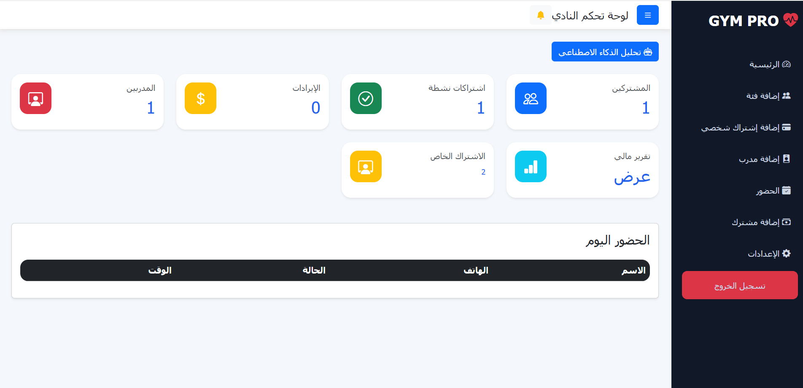

🏋️ py_gym – AI-Powered Gym Management System

py_gym is a web-based Gym Management System developed using Python, Flask, and MySQL. It is designed to simplify gym operations by managing members, trainers, daily attendance, monthly subscriptions, and financial reports.

The system also integrates Artificial Intelligence and data analysis using Pandas to help administrators access important statistics, analyze financial performance, and make better management decisions.

🚀 Features
👥 1. Member Management
Register and manage gym members.
Store and organize member information.
Track membership status.
🏋️ 2. Trainer Management
Manage gym trainers.
Track the number of registered trainers.
Organize trainer information.
📅 3. Attendance Management
Record daily member attendance.
Track present and absent members.
Maintain daily attendance records.
Review attendance history.
💳 4. Monthly Subscription Management
Manage monthly subscriptions.
Track subscription expiration dates.
Monitor active and expired memberships.
Automatically calculate subscription information.
💰 5. Financial Management
Track gym payments and revenue.
Monitor financial information.
Calculate total revenue.
Review payment records.
🤖 6. AI-Powered Admin Assistant

An integrated AI assistant designed to help gym administrators access important information quickly and easily.

Features include:

Get information about gym earnings.
Check the number of registered trainers.
Find out how many members attended today.
Ask questions about gym statistics.
Access administrative information through AI assistance.
📊 7. Data Analysis & Financial Reports

The system includes a financial data analysis module using Python and Pandas to analyze payment records and generate useful financial statistics.

Features include:

Total Revenue: Calculate total revenue from paid transactions.
Monthly Revenue Analysis: Analyze revenue month by month.
Average Revenue: Calculate average payment amounts.
Payment Statistics: Count successful payment transactions.
Maximum Payment: Identify the highest payment.
Minimum Payment: Identify the lowest payment.
📸 Screenshots
Admin Dashboard

!py_gym Dashboard

🛠️ Technologies Used
Technology	Purpose
Python	Main programming language
Flask	Web application framework
MySQL	Database management
Pandas	Data analysis and financial reports
Artificial Intelligence	Smart administrative assistance
HTML5	Frontend structure
CSS3	Frontend styling
JavaScript	Frontend interactivity
📂 Project Structure
text
py_gym/
│
├── gym.py
├── README.md
├── requirements.txt
│
├── templates/
│
├── static/
│
├## 📸 Screenshots

### Admin Dashboard

└── ...

Note: The project structure above is illustrative. Adjust it to match your actual files and folders.

⚙️ Installation
1. Clone the Repository
bash
git clone YOUR_REPOSITORY_URL

2. Navigate to the Project Directory
bash
cd py_gym

3. Create a Virtual Environment
bash
python -m venv venv

4. Activate the Virtual Environment

Windows:

bash
venv\Scripts\activate

Linux / macOS:

bash
source venv/bin/activate

5. Install Dependencies
bash
pip install -r requirements.txt

🗄️ Database Configuration
Install and start MySQL.
Create the project database.
Configure your MySQL connection settings.
Create or import the required database tables.
▶️ Run the Application

Start the Flask application:

bash
python gym.py

Open your browser and visit:

text
http://127.0.0.1:5000

🔮 Future Improvements
Advanced financial analytics and visualizations.
More AI-powered administrative features.
Automated subscription expiration notifications.
Detailed attendance reports.
Improved financial dashboards.
Enhanced member and trainer management.
👨‍💻 Project Information
Project Name: py_gym
Project Type: AI-Powered Gym Management System
Backend: Python & Flask
Database: MySQL
Data Analysis: Pandas
AI Integration: AI-Powered Admin Assistant
⭐ Support

If you find this project useful, consider giving it a star on GitHub!

py_gym – Smart Management, Better Performance. 🏋️🤖